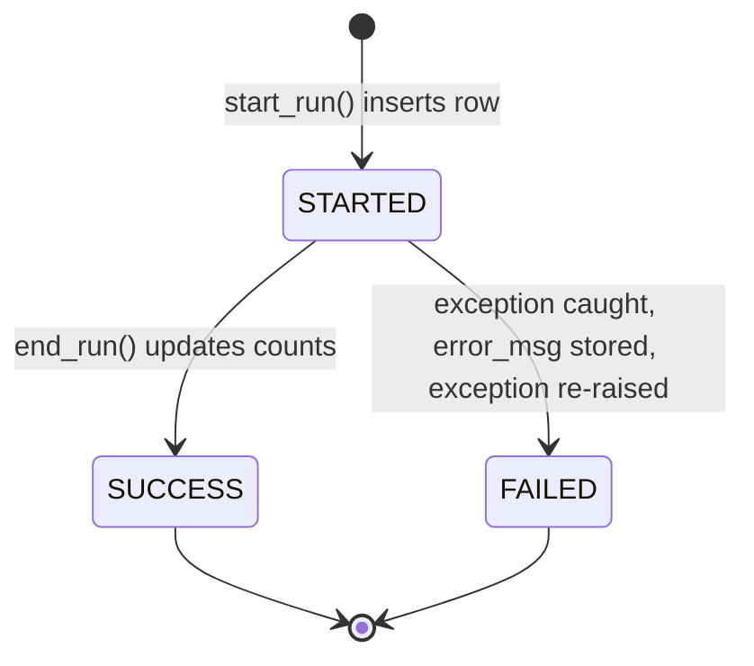

# Control Framework (WBS 2.4)

The `ops` schema holds the **metadata that drives the pipeline** and the **audit trail of what it did**.

| Table | Answers the question | Written by |
|---|---|---|
| `ingestion_control` | What sources exist, and where do I resume? | Seeded in setup. Watermark updated by silver. |
| `batch_run_log` | What ran, when, did it succeed, and how many rows? | Every notebook (`start_run` / `end_run`) |
| `file_manifest` | Which file came in on which run? | Bronze |
| `dq_rule` | Which quality rules apply? | Seeded in setup |
| `dq_result` | How did each rule do on each run? | Silver DQ engine |
| `quarantine_beneficiary`, `quarantine_txn` | Which rows were rejected, and why? | Silver DQ engine |
| `remediation_log` | What did we fix, how, and who did it? | Remediation notebook |

## Run lifecycle



- `run_id` = new UUID per notebook execution. `job_run_id` = the Databricks Job run (`{{job.run_id}}`), which links every task of one pipeline run.
- A FAILED run re-raises its error, so the Job sees the failure and the retry policy applies.
- A row stuck in `STARTED` means the process died mid-run. That's visible, not silent.

## Incrementality: two mechanisms

| Layer | Mechanism | Reset for backfill |
|---|---|---|
| Landing → Bronze | Auto Loader **checkpoint** (which files were seen) | New checkpoint path |
| Bronze → Silver | **Watermark** in `ingestion_control.watermark_value` (max `_ingest_ts` processed) | `UPDATE ingestion_control SET watermark_value = NULL` |

## DDL (goes into `01_setup`)

```sql
CREATE TABLE IF NOT EXISTS msf_demo.ops.ingestion_control (
  source_name       STRING  NOT NULL,   -- beneficiary, assistance_txn, scheme, office, planning_area
  source_path       STRING  NOT NULL,   -- /Volumes/msf_demo/landing/raw_files/<source>/
  file_format       STRING  NOT NULL,   -- csv | json
  bronze_table      STRING  NOT NULL,
  silver_table      STRING  NOT NULL,
  business_key      STRING  NOT NULL,
  load_type         STRING  NOT NULL,   -- incremental | full
  watermark_value   TIMESTAMP,          -- last bronze _ingest_ts processed into silver
  is_active         BOOLEAN NOT NULL,
  owner             STRING,
  updated_ts        TIMESTAMP
);

CREATE TABLE IF NOT EXISTS msf_demo.ops.batch_run_log (
  run_id         STRING NOT NULL,
  job_run_id     STRING,
  batch_date     DATE,
  layer          STRING,              -- bronze | silver | gold | ops
  table_name     STRING,
  status         STRING NOT NULL,     -- STARTED | SUCCESS | FAILED
  start_ts       TIMESTAMP,
  end_ts         TIMESTAMP,
  rows_in        BIGINT,
  rows_out       BIGINT,
  rows_rejected  BIGINT,
  error_msg      STRING
);

CREATE TABLE IF NOT EXISTS msf_demo.ops.file_manifest (
  file_path    STRING NOT NULL,
  source_name  STRING,
  batch_date   DATE,
  file_size    BIGINT,
  file_mod_ts  TIMESTAMP,
  row_count    BIGINT,
  run_id       STRING,
  ingest_ts    TIMESTAMP
);

CREATE TABLE IF NOT EXISTS msf_demo.ops.dq_rule (
  rule_id      STRING  NOT NULL,
  target_table STRING  NOT NULL,
  column_name  STRING,
  rule_expr    STRING  NOT NULL,   -- SQL boolean; TRUE = pass, NULL counts as fail
  severity     STRING  NOT NULL,   -- REJECT (quarantine row) | WARN (keep row, record failure)
  description  STRING,
  is_active    BOOLEAN NOT NULL
);

CREATE TABLE IF NOT EXISTS msf_demo.ops.dq_result (
  run_id        STRING,
  rule_id       STRING,
  target_table  STRING,
  severity      STRING,
  rows_checked  BIGINT,
  rows_failed   BIGINT,
  result_ts     TIMESTAMP
);

CREATE TABLE IF NOT EXISTS msf_demo.ops.remediation_log (
  remediation_id  STRING,
  scenario        STRING,   -- REPLAY | ROLLBACK | INFERRED_MEMBER | BACKFILL
  target_table    STRING,
  action          STRING,   -- the SQL / operation performed
  rows_affected   BIGINT,
  reason          STRING,
  performed_by    STRING,   -- current_user()
  run_id          STRING,
  performed_ts    TIMESTAMP
);
```

Quarantine tables are created by silver on first write: the **bronze columns (all STRING)** plus
`failed_rules ARRAY<STRING>`, `quarantine_ts TIMESTAMP`, `status STRING` (OPEN | REPLAYED | DISCARDED), `resolved_run_id STRING`, `resolved_ts TIMESTAMP`.

## DQ rule seed

Rules run **after** standardisation, on a DataFrame already left-joined to `slv_scheme`. That's why the referential checks can be written as plain expressions.

| rule_id | target | rule_expr | severity |
|---|---|---|---|
| BEN_001 | slv_beneficiary | `nric IS NOT NULL` | REJECT |
| BEN_002 | slv_beneficiary | `nric RLIKE '^[STFGM][0-9]{7}[A-Z]$'` | REJECT |
| BEN_003 | slv_beneficiary | `dob IS NOT NULL AND dob <= current_date()` | REJECT |
| BEN_004 | slv_beneficiary | `postal_code RLIKE '^[0-9]{6}$'` | WARN |
| BEN_005 | slv_beneficiary | `household_size BETWEEN 1 AND 15` | REJECT |
| BEN_006 | slv_beneficiary | `monthly_household_income >= 0` | REJECT |
| TXN_001 | slv_assistance_txn | `amount > 0` | REJECT |
| TXN_002 | slv_assistance_txn | `disbursement_date IS NOT NULL AND disbursement_date <= current_date()` | REJECT |
| TXN_003 | slv_assistance_txn | `max_monthly_amount IS NOT NULL` (scheme exists) | REJECT |
| TXN_004 | slv_assistance_txn | `amount <= max_monthly_amount` | WARN |
| TXN_005 | slv_assistance_txn | `status IN ('DISBURSED','PENDING','REVERSED')` | REJECT |

TXN_004 is deliberately a WARN. On Day 3 the "cents not dollars" bad file passes every REJECT rule but trips TXN_004 on almost every row. The WARN spike in `dq_result` is how the bad batch gets detected, and it's then rolled back by `_run_id`.
