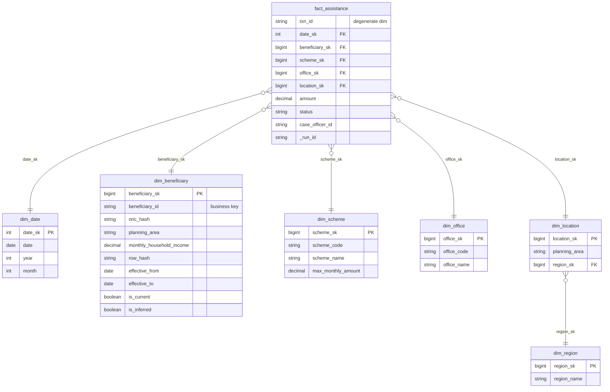

# Gold Data Model (WBS 2.3)

## Fact grain
**One row in `fact_assistance` = one disbursement transaction (`txn_id`).**
`txn_id` is kept on the fact as a degenerate dimension.

## ERD (snowflake variant)

**Star variant:** replace `dim_location` + `dim_region` with `dim_location_flat` (planning_area, region_name), using the same `location_sk`. The fact table doesn't change.

**Wide variant:** `obt_assistance_wide` = fact joined to every dimension and flattened into one table. No joins are needed at query time.

## Key rules

| Rule | Detail |
|---|---|
| Surrogate keys | `*_sk BIGINT GENERATED ALWAYS AS IDENTITY`. Facts reference surrogate keys, never business keys. |
| SCD2 tracked columns | address_enc, planning_area, household_size, monthly_household_income, employment_status. Change is detected with `row_hash = sha2(concat_ws('\|', …), 256)`. |
| SCD2 untracked (Type 1) | full_name, phone_enc, preferred_language: overwritten on the current row. |
| SCD2 validity | `effective_from` = source `updated_at` date (first version: `1900-01-01`), `effective_to` = next version's `effective_from`, or `9999-12-31` for the current row. Half-open interval: `[from, to)`. |
| Point-in-time join | `fact.beneficiary_sk` = the version where `disbursement_date >= effective_from AND disbursement_date < effective_to`. |
| Location on fact | Taken from **that** beneficiary version's planning_area, so a move changes the location of later txns only. |
| Inferred member | A txn for an unknown `beneficiary_id` creates a placeholder row (`is_inferred = true`, attributes `UNKNOWN`). When the real record arrives, it is updated in place (no new version) and `is_inferred` becomes false. |
| Unknown member | `-1` rows in each dimension for unresolvable lookups, so fact FKs are never NULL. |

## When to use which

| Model | Strength | Cost | Used here for |
|---|---|---|---|
| Star | Simple joins, BI-friendly | Some redundancy (region repeated per area) | Default reporting |
| Snowflake | Normalised, one place to change region | More joins | Showing the trade-off |
| Wide (OBT) | No joins, fast scans, ML-ready | Big table, has to be rebuilt when dimensions change | Dashboards, ML features |
